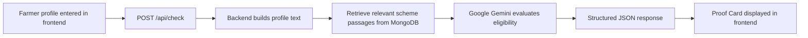

<!-- Improved compatibility of back to top link: See: https://github.com/othneildrew/Best-README-Template/pull/73 -->
<a id="readme-top"></a>

<!-- PROJECT SHIELDS -->
[![Contributors][contributors-shield]][contributors-url]
[![Forks][forks-shield]][forks-url]
[![Stargazers][stars-shield]][stars-url]
[![Issues][issues-shield]][issues-url]


<!-- PROJECT LOGO -->
<br />
<div align="center">
<h3 align="center">Niti-Setu</h3>

  <p align="center">
    An AI-assisted eligibility engine for Indian agricultural schemes.
    <br />
    <a href="https://github.com/Rhytam23/nitisetu"><strong>Explore the docs »</strong></a>
    <br />
    <br />
    <a href="https://github.com/Rhytam23/nitisetu/issues/new?labels=bug">Report Bug</a>
    &middot;
    <a href="https://github.com/Rhytam23/nitisetu/issues/new?labels=enhancement">Request Feature</a>
  </p>
</div>


<!-- TABLE OF CONTENTS -->
<details>
  <summary>Table of Contents</summary>
  <ol>
    <li>
      <a href="#about-the-project">About The Project</a>
      <ul>
        <li><a href="#built-with">Built With</a></li>
      </ul>
    </li>
    <li><a href="#getting-started">Getting Started</a></li>
    <li><a href="#usage">Usage</a></li>
    <li><a href="#roadmap">Roadmap</a></li>
    <li><a href="#contributing">Contributing</a></li>
    <li><a href="#license">License</a></li>
    <li><a href="#contact">Contact</a></li>
  </ol>
</details>


<!-- ABOUT THE PROJECT -->
## About The Project

> An AI-assisted eligibility engine for Indian agricultural schemes.

Niti-Setu helps farmers understand whether they qualify for schemes such as PM-KISAN, PM-KMY, and PM-KUSUM by combining a guided React experience, a Node.js API, MongoDB storage, and retrieval over official scheme documents.

### At a Glance


| Layer | Stack |
| --- | --- |
| Frontend | React, Vite, Tailwind CSS |
| Backend | Node.js, Express, Mongoose |
| AI / RAG | LangChain, Google Gemini, MongoDB Atlas Vector Search |
| Storage | MongoDB |
| Deployment | Vercel-ready backend |

### What It Does


- Collects farmer details through a polished step-by-step UI.
- Compares profiles against official PDF guidelines.
- Produces a structured verdict with status, reasoning, proof text, citation, and required documents.
- Falls back to deterministic rules when the AI or retrieval layer is unavailable.
- Stores farmer profiles in MongoDB when the database is online.

### Supported Schemes


- PM-KISAN
- PM-KMY
- PM-KUSUM

### Repository Layout


```text
.
|-- backend/        Express API, MongoDB models, RAG logic, scheme data
|-- frontend/       Vite app, UI components, assets, and styling
|-- doc/            Project notes and supporting documents
`-- PDF/            Reference material
```

### How It Works




### Response Shape


The eligibility endpoint returns a response like this:

```json
{
  "success": true,
  "message": "Eligibility checked successfully.",
  "data": {
    "status": "Eligible",
    "reasoning": "Short explanation in the selected language.",
    "document_proof": "Verbatim supporting text from the source document.",
    "citation": "Source document name",
    "required_documents": ["Aadhaar Card", "Land Record", "Bank Passbook"]
  }
}
```

### Project Notes


- The frontend uses a landing page plus a consultation flow.
- The backend includes a rules-based fallback so the app remains usable if RAG is unavailable.
- Scheme documents live in `backend/data/` and are used to support retrieval and citations.
- The backend is configured for serverless deployment through `vercel.json`.

### Deployment


#### Backend

- Set production environment variables in your hosting provider.
- Ensure `MONGODB_URI` and `GOOGLE_API_KEY` are available at runtime.

#### Frontend

- Point `VITE_API_URL` to the deployed backend.
- Rebuild after changing production environment variables.

### Tips


- Keep the backend and frontend running at the same time during local development.
- If the UI cannot reach the API, check the backend port and the `VITE_API_URL` value.
- If eligibility returns fallback output, verify MongoDB connectivity and the Gemini API key.

---

### 📖 Project Understanding (Future Reference)


Niti-Setu helps Indian farmers understand whether they qualify for government agricultural
schemes (PM-KISAN, PM-KMY, PM-KUSUM) through a guided step-by-step UI. It combines a Node/Express
API, MongoDB storage, and retrieval-augmented generation (LangChain + Google Gemini + MongoDB
Atlas Vector Search) over the official scheme PDFs to produce a structured verdict — status,
reasoning, proof text, citation, and required documents — with a deterministic rules fallback
when the AI/retrieval layer is unavailable.

**Stack:** React + Vite + Tailwind (frontend) · Node.js + Express + Mongoose (backend) ·
LangChain + Gemini + MongoDB Atlas Vector Search (RAG).
**Status:** functional govtech/agritech tool, deployable on Vercel, with graceful degradation
built in.

### 🎯 Where This Can Be Used


- Farmer-facing scheme-eligibility checker — real social-impact utility for an underserved user
  base.
- Govtech/agritech portfolio piece demonstrating RAG-over-official-documents done responsibly
  (citations + deterministic fallback, not just an LLM guessing).
- **Hackathons:** strong fit for govtech/agritech/social-impact tracks in India — the
  "works even without AI" fallback design is a genuinely good answer to the judge question
  "what happens when the model is wrong or down?"

<p align="right">(<a href="#readme-top">back to top</a>)</p>


### Built With

* [](https://react.dev/)
* [](https://vitejs.dev/)
* [](https://tailwindcss.com/)
* [](https://expressjs.com/)
* [](https://www.mongodb.com/)
* [](https://www.langchain.com/)

<p align="right">(<a href="#readme-top">back to top</a>)</p>


<!-- GETTING STARTED -->
## Getting Started

### Requirements


- Node.js 18 or newer
- npm
- MongoDB Atlas or another MongoDB instance
- Google Gemini API key

### Environment Setup


Create `backend/.env`:

```env
PORT=5001
MONGODB_URI=mongodb+srv://<username>:<password>@cluster0.mongodb.net/?retryWrites=true&w=majority
GOOGLE_API_KEY=your_gemini_api_key_here
```

Optional `frontend/.env` or `frontend/.env.production`:

```env
VITE_API_URL=http://localhost:5001
```

If `VITE_API_URL` is not set, the frontend uses `http://localhost:5001/api/check`.

### Quick Start


#### 1. Install dependencies

```bash
cd backend
npm install

cd ../frontend
npm install
```

#### 2. Start the backend

```bash
cd backend
npm start
```

#### 3. Start the frontend

```bash
cd frontend
npm run dev
```

Vite will show the local URL, usually `http://localhost:5173`.

<p align="right">(<a href="#readme-top">back to top</a>)</p>


<!-- USAGE EXAMPLES -->
## Usage

### API Endpoints


| Method | Endpoint | Purpose |
| --- | --- | --- |
| `GET` | `/api/health` | Health check and database status |
| `POST` | `/api/check` | Run scheme eligibility analysis |
| `POST` | `/api/profile` | Create a farmer profile |
| `GET` | `/api/profile` | List saved profiles |
| `GET` | `/api/profile/:id` | Fetch one profile |
| `PUT` | `/api/profile/:id` | Update a profile |
| `DELETE` | `/api/profile/:id` | Delete a profile |

<p align="right">(<a href="#readme-top">back to top</a>)</p>


<!-- ROADMAP -->
## Roadmap

See the [open issues](https://github.com/Rhytam23/nitisetu/issues) for a full list of proposed features (and known issues).

<p align="right">(<a href="#readme-top">back to top</a>)</p>


<!-- CONTRIBUTING -->
## Contributing

Contributions are what make the open source community such an amazing place to learn, inspire, and create. Any contributions you make are **greatly appreciated**.

If you have a suggestion that would make this better, please fork the repo and create a pull request. You can also simply open an issue with the tag "enhancement".
Don't forget to give the project a star! Thanks again!

1. Fork the Project
2. Create your Feature Branch (`git checkout -b feature/AmazingFeature`)
3. Commit your Changes (`git commit -m 'Add some AmazingFeature'`)
4. Push to the Branch (`git push origin feature/AmazingFeature`)
5. Open a Pull Request

<p align="right">(<a href="#readme-top">back to top</a>)</p>


<!-- LICENSE -->
## License

No license file has been added to this repository yet.

<p align="right">(<a href="#readme-top">back to top</a>)</p>


<!-- CONTACT -->
## Contact

Rhytam Biswas - [@Rhytam23](https://github.com/Rhytam23)

Project Link: [https://github.com/Rhytam23/nitisetu](https://github.com/Rhytam23/nitisetu)

<p align="right">(<a href="#readme-top">back to top</a>)</p>


<!-- MARKDOWN LINKS & IMAGES -->
[contributors-shield]: https://img.shields.io/github/contributors/Rhytam23/nitisetu.svg?style=for-the-badge
[contributors-url]: https://github.com/Rhytam23/nitisetu/graphs/contributors
[forks-shield]: https://img.shields.io/github/forks/Rhytam23/nitisetu.svg?style=for-the-badge
[forks-url]: https://github.com/Rhytam23/nitisetu/network/members
[stars-shield]: https://img.shields.io/github/stars/Rhytam23/nitisetu.svg?style=for-the-badge
[stars-url]: https://github.com/Rhytam23/nitisetu/stargazers
[issues-shield]: https://img.shields.io/github/issues/Rhytam23/nitisetu.svg?style=for-the-badge
[issues-url]: https://github.com/Rhytam23/nitisetu/issues
